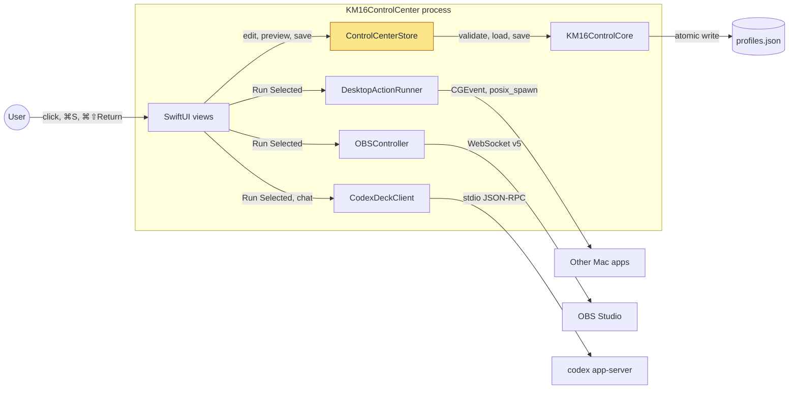
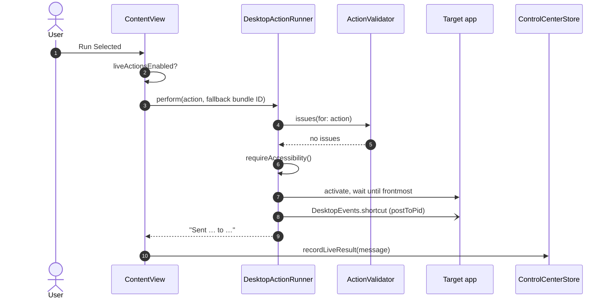
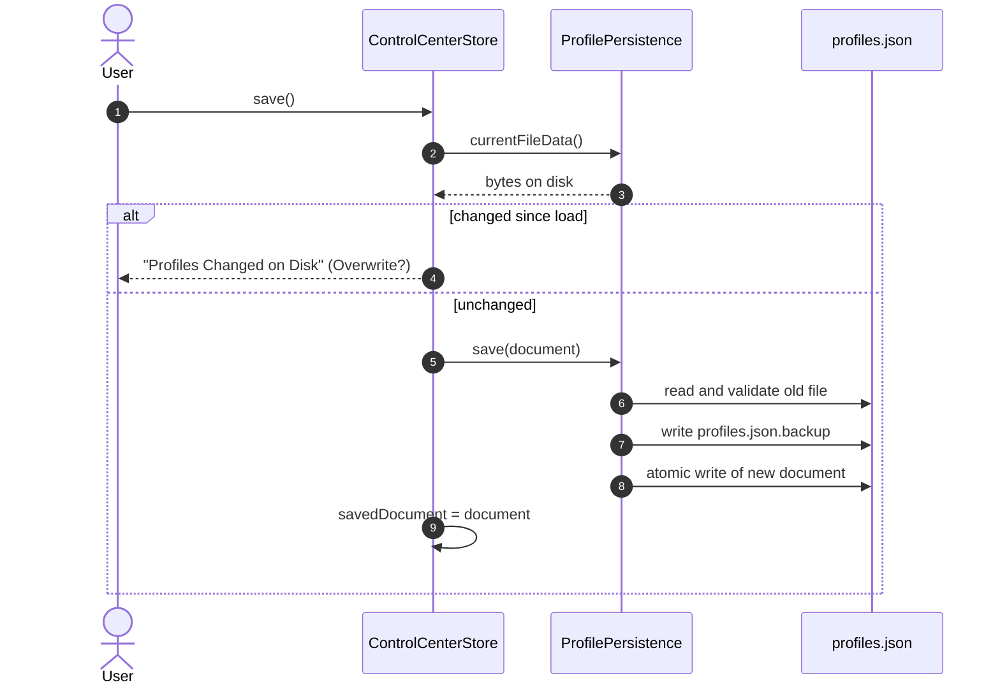
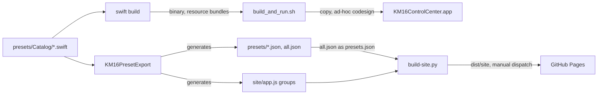

# KM16 Control Center architecture

KM16 Control Center is a SwiftPM macOS app for software profiles and explicit
desktop/service actions. Profiles do not synchronize with device firmware layers.

## System overview

What runs where, and what does the app talk to? Everything inside the box runs
in one macOS process; the boxes outside it are other programs on the Mac or on
the network. The pad itself is not connected.

Edits, Preview and Save stay inside the process: `ControlCenterStore` changes
the working document and `KM16ControlCore` validates and persists it. Only
**Run Selected** with live actions enabled reaches the three providers, and
`ContentView` calls each provider directly, not through the store. The store
only records the result.

Where in the code:
- [App/KM16ControlCenterApp.swift](../../Sources/KM16ControlCenter/App/KM16ControlCenterApp.swift): scenes (main, overlay, Connections, Settings) and the one shared store
- [Stores/ControlCenterStore.swift](../../Sources/KM16ControlCenter/Stores/ControlCenterStore.swift): session state
- [Views/ContentView.swift](../../Sources/KM16ControlCenter/Views/ContentView.swift): toolbar and `runSelected()`
- [DesktopActionRunner.swift](../../Sources/KM16Integrations/DesktopActionRunner.swift), [OBSController.swift](../../Sources/KM16Integrations/OBSController.swift), [CodexDeckClient.swift](../../Sources/KM16Integrations/CodexDeckClient.swift): the providers

## Package structure

The Swift package is at the repository root. Dependencies point downward only:
the app depends on everything, and Core depends on nothing in the package.

| Target | Location | Responsibility |
| --- | --- | --- |
| `KM16ControlCore` | `Sources/KM16ControlCore` | Control IDs, action and profile models, validation, schema migration, persistence, library editing rules (`ProfileLibrary`), grouping, and simulation. No AppKit or SwiftUI |
| `KM16Presets` | `presets/` | Factory preset definitions (`Catalog/`), the bundled setup guides (`setup/`), and the generated JSON exports |
| `KM16Integrations` | `Sources/KM16Integrations` | Side effects: desktop input, audio, windows, bounded processes, OBS, the Codex transport, and saved HID capture decoding |
| `KM16ProcessSupport` | `Sources/KM16ProcessSupport` | C bridge that spawns an owned process group with explicit file descriptors |
| `KM16ControlCenter` | `Sources/KM16ControlCenter` | SwiftUI app: scenes, the shared observable store, editors, settings, and AppKit bridges |
| `KM16PresetExport` | `Sources/KM16PresetExport` | Command-line generator for the preset JSON exports and the browser demo's group list; `--check` reports stale files |

`ControlCenterStore` owns session state: the working document, undo and redo,
dirty tracking, status messages, selection, and foreground-app bookkeeping. It
delegates library rules such as naming, merge import, and profile-switch
resolution to `ProfileLibrary`, which receives factory presets as values rather
than depending on the catalog. Live actions are routed from the main window's Run
Selected command to the desktop runner, the OBS controller, or the Codex client.

Preset definitions are Swift. `presets/<id>.json`, `presets/all.json`, and the
`groups` list in `site/app.js` are generated by `swift run KM16PresetExport`; the
browser demo reads `all.json`. The app bundles
`presets/setup/` unchanged, and Export Setup Files copies that folder.

The app shares one store and its providers across windows. Connection panels reuse
those providers. Termination handles unsaved profiles and stops owned providers.

## Input and actions

### What happens on Run Selected

What does **Run Selected** (⌘⇧Return) do with a shortcut assignment?

At step 2, a disabled live-action setting or a profile-switch action turns the
run into a Preview: `store.simulate` is called and nothing leaves the process.
OBS and agent actions branch at step 3 to `OBSController.perform` and
`CodexDeckClient.perform` instead. Commands (`.shell`) skip steps 6–7 and run
through `BoundedProcessRunner`, which spawns the executable in its own process
group through the `km16_spawn_group` C shim. A thrown error is recorded as
"Run failed: …" at step 10.

Preview (⌘Return) is the short path: `ControlCenterStore.simulate` calls
`SimulationDispatcher.dispatch`, which validates the action and records a
"Would run …" event.

Where in the code:
- [Views/ContentView.swift](../../Sources/KM16ControlCenter/Views/ContentView.swift): `runSelected()`
- [DesktopActionRunner.swift](../../Sources/KM16Integrations/DesktopActionRunner.swift): `perform`, `requireAccessibility`, `focus`
- [DesktopEvents.swift](../../Sources/KM16Integrations/DesktopEvents.swift), [ProcessRunner.swift](../../Sources/KM16Integrations/ProcessRunner.swift), [ProcessSupport.c](../../Sources/KM16ProcessSupport/ProcessSupport.c): input events and commands
- [Simulation.swift](../../Sources/KM16ControlCore/Simulation.swift), [ActionSpecifications.swift](../../Sources/KM16ControlCore/ActionSpecifications.swift): Preview and validation

### Preview, replay and live-action rules

The 25 input slots cover 16 keys and three actions per knob. Preview and saved-capture
replay resolve assignments in the selected profile and produce bounded simulation
events. Profile-switch actions change local state. Neither path calls a live provider.

Run Selected requires live actions to be enabled. Desktop input validates the
action, checks Accessibility access, focuses the target app, and posts input to
that process. Commands use an absolute executable and literal arguments. Output
is drained and discarded; execution time and child-process lifetime are bounded;
unrelated parent file descriptors are not inherited. The activity log omits raw
snippets, command arguments, and prompts.

OBS actions use a short-lived WebSocket v5 connection. The endpoint and source names
are saved locally; the password remains in memory. Protocol code checks authentication,
request correlation, and status before reporting an action as complete.

The stock HID decoder handles the captured composite interface `28e9:3145`.
Report 6 contains a modifier byte and a 240-bit usage bitmap; report 4 contains a
little-endian consumer usage. Edge tracking suppresses held reports. These mappings
are specific to the studied stock layer. Fn and two knob presses were not visible
in the captures. The app does not enumerate or open HID devices.

## Profiles and persistence

What happens on Save (⌘S), and which files end up on disk?

The file lives at `~/Library/Application Support/KM16ControlCenter/profiles.json`
unless `--profiles-path` or `KM16_PROFILES_PATH` overrides it. If the old file
does not validate at step 6, it is copied to
`profiles.json.recovery-<time>-<uuid>.json` instead of replacing the backup.
Overwrite in the dialog calls `save(overwritingExternalChanges: true)`. OBS and
Codex settings live in `UserDefaults`, not in the profiles file.

Where in the code:
- [Persistence.swift](../../Sources/KM16ControlCore/Persistence.swift): `ProfilePersistence` (load, save, import, export, recovery)
- [ControlModels.swift](../../Sources/KM16ControlCore/ControlModels.swift): `ProfileDocument`, `Profile`, `Binding`, `ControlAction`
- [AppConfiguration.swift](../../Sources/KM16ControlCenter/Models/AppConfiguration.swift): profiles path overrides

### Profile and storage rules

Profiles contain a UUID, name, preset origin, summary, app-matching rules, and one
binding per control. Schema 1 migrates to schema 2 in memory. Incomplete legacy
actions can be edited but must pass validation before saving.

Import supports replacement and two same-name merge policies. Importing never runs
an action or changes the live-action preference. The import sheet warns that a
profile may run any absolute executable as the current macOS user or send a custom
prompt to the selected Codex thread. Saves validate and atomically replace the
document, retain the previous valid revision as a backup, and make a separate
recovery copy of an invalid original.
Reads enforce the 8 MiB limit and reject nonregular files and final-component symlinks.
The library permits 128 profiles; undo history holds 100 revisions and activity 80 events.

Display order groups profiles by use. Foreground matching follows document order,
falls back to Desktop, and yields to a manual override. Selecting a software profile
does not change a layer on the device.

## Codex transport

Agent Deck was implemented against the Codex CLI 0.154.0 app-server protocol.
It owns a stdio app-server process and completes initialization before requesting
models or threads. The installed CLI supplies authentication.

The client lists workspace threads, starts and resumes tasks, submits or steers
prompts, interrupts turns, and displays output, plans, and diffs. Each thread has
separate state; completed-turn tracking handles delayed responses.
Approval and question replies preserve request IDs and reject stale requests.
New threads request `workspace-write` sandboxing and `on-request` approvals; the UI
does not offer persistent permission grants. Resumed threads keep their existing
server-owned permissions, which may be broader. The app does not inspect or replace
their sandbox, approval policy, workspace, or enabled tools. Sending a message is
separate from the Run Selected opt-in.

The transport bounds frames, buffered input, pending requests, and request time.
Its ordered reader accepts fragmented JSON lines; a separate queue writes to the
child process. Completion and cancellation release request timers. Disconnect
invalidates the connection generation and fails outstanding requests.

## Build and release

How do the Swift sources become the app, the preset exports and the demo site?

`swift run KM16PresetExport --check` fails when the generated files are stale,
so commit the regenerated JSON with every catalog change. `build_and_run.sh`
checks that the setup guides are inside the packaged presets bundle before it
signs the app. The `macos` job in [offline.yml](../../.github/workflows/offline.yml)
runs on manual dispatch and on Dependabot PRs; [pages.yml](../../.github/workflows/pages.yml)
deploys the demo only on a manual run from `main`. Releases are covered in
[RELEASING.md](../RELEASING.md).

## Code map

In the order a newcomer would read it:

| Path | Responsibility |
| --- | --- |
| [Package.swift](../../Package.swift) | Targets and their dependencies |
| [KM16ControlCore/ControlModels.swift](../../Sources/KM16ControlCore/ControlModels.swift) | Controls, actions, profiles, the document |
| [KM16ControlCore/ActionSpecifications.swift](../../Sources/KM16ControlCore/ActionSpecifications.swift) | Action validation and parameter parsing |
| [KM16ControlCore/Persistence.swift](../../Sources/KM16ControlCore/Persistence.swift) | Load, migrate, save, import, export |
| [KM16ControlCore/ProfileLibrary.swift](../../Sources/KM16ControlCore/ProfileLibrary.swift) | Naming, merge import, profile switching |
| [Stores/ControlCenterStore.swift](../../Sources/KM16ControlCenter/Stores/ControlCenterStore.swift) | Session state, undo, the save flow |
| [Views/ContentView.swift](../../Sources/KM16ControlCenter/Views/ContentView.swift) | Main window, toolbar, Run Selected |
| [Sources/KM16Integrations/](../../Sources/KM16Integrations) | Desktop input, processes, OBS, Codex, HID capture decoding |
| [presets/Catalog/](../../presets/Catalog) | Factory presets (source of truth) |
| [KM16PresetExport/main.swift](../../Sources/KM16PresetExport/main.swift) | Preset JSON and demo group generator |
| [script/build_and_run.sh](../../script/build_and_run.sh) | App bundle assembly and signing |
| [site/](../../site) | Browser demo (simulated actions only) |
| [firmware/custom/](../../firmware/custom) | Portable C firmware core with a host demo |
| [scripts/](../../scripts) | Research, capture and site build tools |
